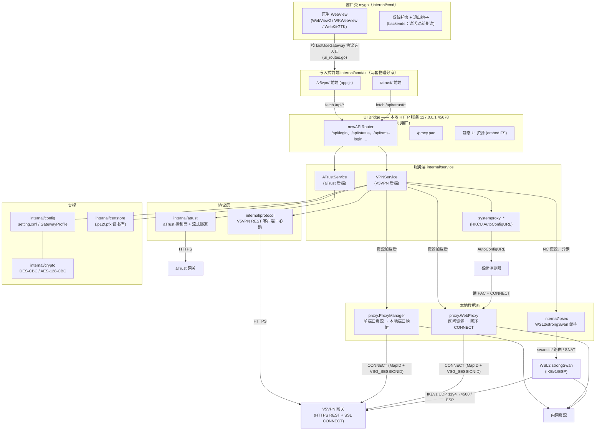
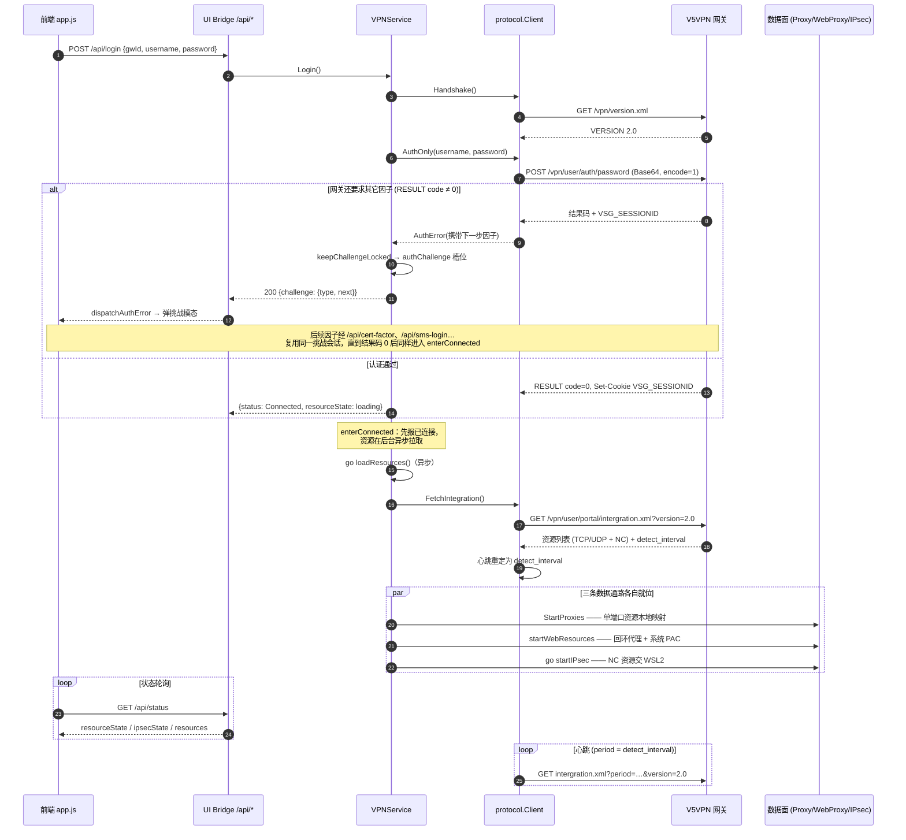

# 总体架构与关键链路（图示）

本文是 `docs/` 各设计文档的**图形化入口**：一张总架构图 + 一条登录主链路的
端到端时序。各机制细节（认证状态机、协议交互、网页代理、IPsec 数据面）
仍以对应文档为准，本文只回答「组件怎么拼起来、一次登录经历了什么」。

| 想看什么 | 去哪 |
|:---|:---|
| 认证状态机与挑战模态 | [`auth-flow.md`](auth-flow.md) |
| 网关 HTTP 协议逐条端点 | [`protocol.md`](protocol.md) |
| 端口区间资源代理与系统 PAC | [`web-proxy.md`](web-proxy.md) |
| NC 资源 IPsec 数据面 | [`ipsec.md`](ipsec.md) |

图中出现的组件名即真实包名 / 路由名，与代码一一对应。

---

## 1. 总架构：单进程、双后端、本地桥

客户端是**一个 Go 桌面进程**（mygo 框架承载原生 WebView），前后端之间
没有跨进程 IPC——前端就是本地 HTTP 服务上的静态页面，`fetch /api/*`
即"IPC"：

阅读要点：

- **两个后端互不感知**（`backends.go` 的三条边界）：`VPNService` 与
  `ATrustService` 在 service 层并列，登录互不路由，UI 按网关 profile 的
  protocol 自己选入口；托盘与退出时由 cmd 层统一判断"谁活动"。
- **前端到后端只有一条路**：本地回环 HTTP。任何 UI 逻辑（挑战模态、
  状态轮询）最终都是 `/api/*` 请求；挑战会话（`VSG_SESSIONID`）永远
  留在 Go 侧，前端只拿 `gwId` + 结果码。
- **三条数据通路并存**：单端口资源走本地端口映射、端口区间资源走
  回环 CONNECT 代理 + 系统 PAC、NC 资源交给 WSL2 里的 strongSwan——
  分别对应 `web-proxy.md`、`ipsec.md` 的设计文档。
- mock 网关（`test/mock/v5vpn`、`test/mock/atrust`）扮演图中最右侧的
  两个网关，是集成与 UI E2E 的裁判。

## 2. 登录主链路：从点击到资源可用

一次口令登录在组件间的完整路径（认证挑战的多跳细节见
[`auth-flow.md`](auth-flow.md)，端点字段见 [`protocol.md`](protocol.md)）：

两个刻意的设计在图上体现为：

- **先连接、后资源**：`AuthOnly` 成功立刻返回 Connected 视图，
  `intergration.xml` 在后台拉取——portal 计算资源慢时用户不会被卡在
  登录页（`vpn_service.go` 的 `enterConnected` → `go loadResources`）。
- **资源失败不拆会话**：拉取失败停在「已连接但获取资源失败」，
  可重试而无需重新认证（`/api/resources/refresh`）。

登出链路（`/api/logout`，顺序即代码顺序）：状态**先**置 Disconnected
（`OnStatusChange` 立即翻转托盘与视图）→ 停 IPsec 与全部本地代理 →
还原系统 PAC → **最后** `Client.Logout()`（`GET /vpn/user/logout`）
告知网关拆会话。
