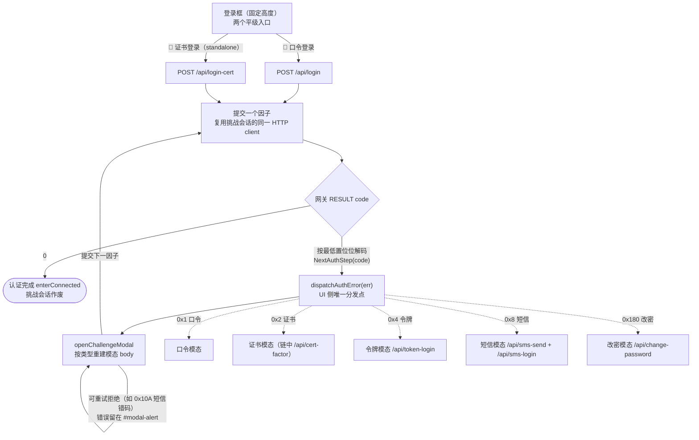
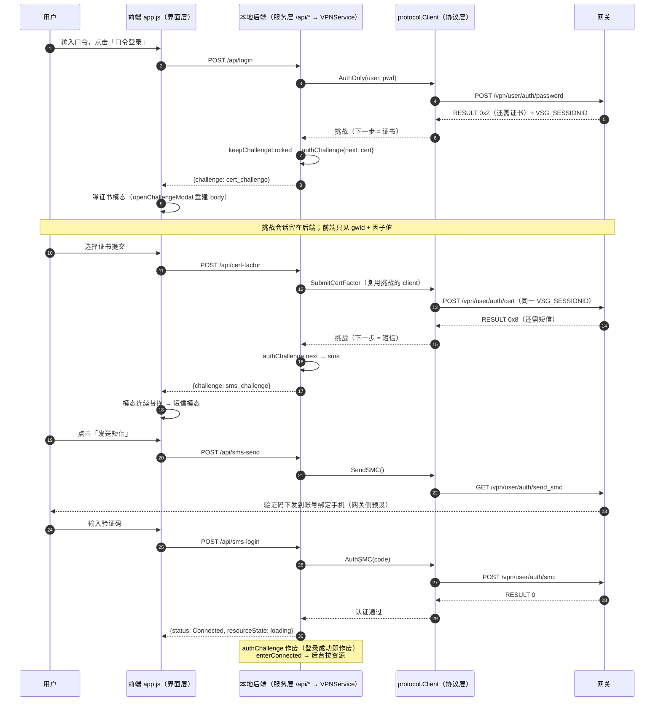

# 认证流程与界面形态（设计决策）

本文记录 V5VPN 登录流程的架构决策：**网关驱动的认证状态机**与**固定表单 +
挑战模态化**的界面形态。这些决策是刻意为之的，改动前请先读完本文——
任何「往登录框里再加一个输入区」或「在客户端写死因子顺序」的实现都是
走偏，会被本文与 `ui_structure_test.go` 的守卫拦下。

适用范围：`internal/protocol`（状态机解码）、`internal/service`（挑战会话）、
`internal/cmd/ui/v5vpn`（界面）。aTrust 界面不在此流程内。

---

## 1. 核心认知：这是状态机，不是因子枚举

网御星云网关的认证不是「单因素 / 双因素 / 三因素」的固定菜单，而是
**网关按账号策略动态编排的因子链**：客户端每提交一个因子，网关在
`RESULT code` 里回答「下一步还要什么」，客户端循环到 `code 0` 为止。
**跳数由网关决定，事先不可知**——同一个客户端可能一跳连上（纯口令），
也可能跳四跳（口令 → 证书 → 短信 → 完成）。

因此客户端的正确姿态只有一种：

> 每提交一个因子，读网关结果码，问下一步要什么；不枚举流程，不写死顺序。



要点读图：**多跳链 = 模态的连续替换**（虚线五种挑战共用一个模态壳，
来一个换一个，登录框永远不动）；挑战会话（`VSG_SESSIONID`）留在
后端 `authChallenge` 槽位，前端只传 `gwId` + 因子值。

反面案例（历史上出现过，勿再犯）：
- 「口令 + 证书」页签把两步串行写死在按钮里 → 网关若在证书后追加短信，
  流程就断了；
- 短信面板假定自己是最后一跳 → 证书 → 短信链无法收尾。

## 2. 三层职责

| 层 | 文件 | 职责 | 唯一分发点 |
|:---|:---|:---|:---|
| 协议 | `internal/protocol/auth.go` | 结果码 → 下一步 | `NextAuthStep(code)` |
| 服务 | `internal/service/vpn_service.go` | 挑战会话的保留与续跳 | `authChallenge.next` 槽位 |
| 界面 | `internal/cmd/ui/v5vpn/app.js` | 结果码 → 下一个模态 | `dispatchAuthError(err)` |

- **协议层**：`RESULT code` 是按位掩码（0x1 口令 / 0x2 证书 / 0x4 令牌 /
  0x8 短信 / 0x180 改密），`NextAuthStep` 按最低置位位优先解码。新增
  因子类型只需在此加一个 `AuthStep*`，不要在别处 switch 结果码。
- **服务层**：网关把待验因子绑定在挑战响应下发的 `VSG_SESSIONID` 上，
  后续因子必须复用同一 HTTP client。挑战保存在**单一** `authChallenge`
  槽位（按 `next` 步骤 + 网关匹配），登录成功即作废。前端只传 `gwId`，
  挑战会话永远留在后端。
- **界面层**：`dispatchAuthError` 是 UI 侧唯一的结果码分发点。四种挑战
  （图形验证码 / 客户端证书 / 短信 / 改密）共用一个模态壳，`openChallengeModal`
  按类型重建 body；**多跳链表现为模态的连续替换**，不是面板堆叠。

三层的协作以「口令 → 证书 → 短信」三跳链（E2E 场景 9）为例：



E2E 场景 11（full-chain）是同一条回路的四跳版本：验证码 → 证书 →
短信 → 令牌，模态逐个替换、会话始终是同一个。

## 3. 界面形态：两个平级入口 + 挑战模态

登录框**只**包含固定内容，高度恒定。**口令登录与证书登录是两个平级的
独立入口**（对应原厂 `Opt_Password` / `Opt_Cert`）——它们是登录的起点，
不是挑战；所有网关挑战都发生在入口**之后**，一律弹模态：

```
网关节点 + ⚙️ 设置
用户名
登录密码
[记住密码] [自动登录]        修改密码
[ 🔑 口令登录 ] [ 🪪 证书登录 ]   ← 两个并排的入口按钮
```

所有网关挑战一律弹模态（`#challenge-modal`），绝不住进登录框：

| 挑战 | 触发码 | 模态 builder | 提交端点 |
|:---|:---|:---|:---|
| 图形验证码 | `verify_code` | `buildVerifycodeBody` | 重发 `/api/login`（带一次性验证码） |
| 客户端证书 | `cert_challenge` | `buildCertBody`（链中模式） | `/api/cert-factor` |
| 短信 | `sms_challenge` | `buildSMSBody` | `/api/sms-send` + `/api/sms-login` |
| 动态令牌 | `token_challenge` | `buildTokenBody` | `/api/token-login` |
| 改密 | `password_expired` | `buildPwdChangeBody` | `/api/change-password` |

**为什么固定表单**：挑战组件住在登录框里时，每弹一个挑战登录框就长高一截，
连败几次后面板堆叠、按钮让位，视觉来回跳。模态化之后登录框永远是一个
尺寸，挑战来去都在浮层里。

**证书入口是按钮不是页签**：证书登录与口令登录是并列的起点（单证书免密
真实存在，口令步不是必经的），所以两个入口并排平级；点击「证书登录」
打开证书模态的 standalone 模式（提交走 `/api/login-cert`），而口令提交后
网关要求证书因子（`0x2`）时的链中模式提交走 `/api/cert-factor`——两种
模式共享 `buildCertBody`，只差提交端点与「证书自动登录」勾选的可见性。

## 4. 不变量（改动前自查）

1. **登录框高度恒定**。任何新挑战都进模态；往 `#login-form` 里加
   挑战组件 = 走偏。`ui_structure_test.go` 的 `TestUIsAreSeparated`
   要求 `challenge-modal` 与 `cert-login-btn` 存在，即为此守卫。
2. **客户端不写死因子链**。不许出现「口令之后一定是短信」之类的假设；
   一切以 `NextAuthStep` 的返回为准。服务层测试
   `TestSubmitCertFactorSurfacesSMSChallenge` 钉死了「证书后还能跳短信」。
3. **挑战会话留在后端**。前端永远只传 `gwId` + 因子值；把 session id
   或 cookie 泄到前端 = 走偏。
4. **模态内错误留在模态内**（`#modal-alert`）：可重试的拒绝
   （`sms_code_error`、证书被拒）不关模态；不可重试的错误经
   `dispatchAuthError` 关模态回表单或换下一个模态。
5. **新增挑战类型的最小路径**：`AuthStep*` 常量 + `NextAuthStep` 分支 +
   `keepChallengeLocked` 认可 + 一个模态 builder + `dispatchAuthError`
   一个分支。不需要新面板、不需要新页签、不需要动登录框。

## 5. 测试地图

| 测试 | 守什么 |
|:---|:---|
| `internal/protocol/smc_auth_test.go` | 短信结果码 → AuthStep 解码契约 |
| `internal/protocol/token_auth_test.go` | 令牌结果码 → AuthStep 解码契约 |
| `internal/service/cert_service_test.go` | 挑战保留/消费、链上下文、持久化 |
| `internal/service/vpn_service_token_test.go` | 令牌挑战保留与重试 |
| `internal/service/vpn_service_smc_test.go` | 短信链上证书因子的保留 |
| `internal/cmd/api_routes_test.go` | 挑战端点的协议守卫与错误形状 |
| `internal/cmd/ui_structure_test.go` | 界面结构：模态存在、id 一致、两套 UI 分家 |
| `test/e2e_v5vpn_multi_test.js` | 11 场景全链截图（含三因素链与全链挑战的模态连续替换） |

E2E 的场景 9（口令 → 证书模态 → 短信模态）与场景 11（full-chain：验证码 →
证书 → 短信 → 令牌，四跳模态连续替换）是本设计的验收样板：模态先后替换、
挑战会话不断、错码原地重试、最终按入口方式记录会话。mock 的 `full-chain`
模式是「所有挑战弹一遍」的极端用例——图形验证码守卫在口令步最前（它随
口令请求重发，没有独立端点），其余因子依次跳完。
