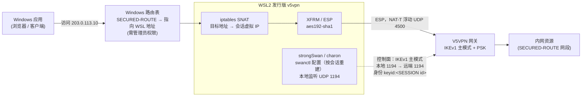
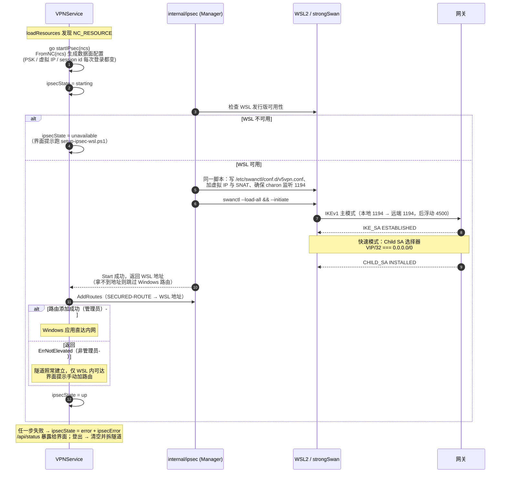

# IPsec（NC 资源）支持现状与实现路径

本文记录 V5VPN 网关下发 `<NC_RESOURCE>`（Network Connect / IPsec 全网状）
时的处理方式，以及完整数据面尚未实现的原因与可选路径。

## 1. NC 资源：是什么，为什么特殊

网关对某些账号策略下发的不是 `<TCPUDP_RESOURCE>`（WEB 资源 / TCP 应用，
客户端为每个资源起本地代理并用 HTTP CONNECT 透传），而是一个
`<NC_RESOURCE>`：

```xml
<RESOURCE_LIST>
  <NC_RESOURCE name='nc'>
    <IKE version='v1'>
      <SERVER ip='198.51.100.10' port='1194' id-type='ipv4' id='198.51.100.10'/>
      <CLIENT port='500' id-type='key_id' id='<session-id>'/>
      <Exchange mode='main'/>
      <PSK key='<pre-shared-key>'/>
    </IKE>
    <PRIVATE-IP ip='10.70.0.5' subnet='255.255.255.255'/>
    <TUNNEL tunnel-name='办公网' mapid='198.51.100.10' status='1'>
      <EXTENSIONS>
        <SECURED-ROUTE><ROUTE addr='198.51.100.0/24'/></SECURED-ROUTE>
      </EXTENSIONS>
    </TUNNEL>
  </NC_RESOURCE>
</RESOURCE_LIST>
```

这是 **IKEv1 主模式 + 预共享密钥 + ESP 隧道模式** 的全网状 IPsec，
客户端拿到的是一组内网路由（`SECURED-ROUTE` / `SECURED-ROUTES`）和一个
虚拟内网 IP（`PRIVATE-IP`）。原厂客户端通过内核虚拟网卡
（`SecTap.sys` / `ndislwf.sys`）承载这些路由；本客户端没有内核态组件，
数据面交给 WSL2 里的 strongSwan 承载（见 §2）。

解析与编排的分工：

- `internal/protocol/models.go` 解析 `NC_RESOURCE`（IKE 参数、虚拟 IP、
  隧道与路由）；`PSK` 带 `json:"-"`，不会进入 API 或界面。
- `SummarizeNCResources` 生成不含密钥的摘要，`/api/status` 以
  `ipsecResources` 下发。
- NC 隧道不产生本地代理行：当 TCP/UDP 资源为 0 时，资源表列出下发的
  隧道名称与路由，并按 `ipsecState` 给出隧道状态（状态条见连接页顶部），
  而不是只显示「未发现资源」。
- 资源加载后若存在 NC 资源，日志记录一条 INFO 并异步拉起隧道；
  建立失败以 ERROR 记录，便于排查「登录成功但 0 资源」。

## 2. 数据面：WSL2 + strongSwan（已实网验证）

数据面不在 Go 里重写 IKE，而是把 strongSwan 跑在 WSL2 里，Go 侧负责编排：



实线是用户数据的路径（Windows 路由 → WSL SNAT → ESP），虚线是 IKE
控制面。Go 侧不在这张图里——`internal/ipsec` 的工作是**编排**：生成
swanctl 配置、拉起连接、加路由，见下面的时序：



- `internal/ipsec`：从 NC 资源生成 swanctl 配置，启动/停止连接，管理路由与 SNAT。
- `VPNService`：资源拉取成功后自动启动隧道，`/api/status` 暴露
  `ipsecState` / `ipsecError`，界面显示状态条。
- Windows 路由：把每个 `SECURED-ROUTE` 指向 WSL 地址；WSL 内把这些目标
  SNAT 到会话虚拟 IP，再交给 XFRM/ESP。添加 Windows 路由需要管理员权限；
  非管理员时隧道仍然建立，但只有 WSL 内可访问，界面会提示。

### 2.1 实网验证到的关键参数（勿随意改动）

| 项 | 值 | 说明 |
|:---|:---|:---|
| IKE 版本/模式 | IKEv1 主模式 | 网关返回 `Exchange mode='main'` |
| IKE 端口 | **本地 1194 → 远端 1194** | 从 500 发不会得到任何回应；这是最容易踩的坑 |
| IKE 提案 | `aes192-sha1-modp1024` | 与网关协商结果一致 |
| ESP 提案 | `aes192-sha1` | AES-CBC-192 / HMAC-SHA1-96 |
| 客户端身份 | `keyid:<SESSION id>` | 会话 ID 每次登录变化 |
| 虚拟 IP | `PRIVATE-IP` | 每次登录变化 |
| Child SA 选择器 | `<VIP>/32 === 0.0.0.0/0` | 不是按 SECURED-ROUTE 逐条协商 |
| NAT-T | UDP 4500 | 主模式后自动浮动到 4500 |

验证结果：IKE_SA/CHILD_SA 均为 ESTABLISHED/INSTALLED；从 WSL 与 Windows
访问 `203.0.113.10:443`、`203.0.113.11:443` 均能建立连接，SA 双向计数
正常增长。

### 2.2 测试覆盖（无 WSL 也能验证的部分）

mock 网关支持 `-nc` 夹具（`only` 替换 TCP/UDP 列表、`mixed` 并存，地址为
TEST-NET、PSK 为显式 mock 值），分四层守卫：

| 层 | 位置 | 验什么 |
|:---|:---|:---|
| 协议解析 | `test/mock/v5vpn/nc_integration_test.go` | IKE/虚拟 IP/路由完整到达客户端；摘要 JSON 不含 PSK；`FromNC` 可生成数据面配置 |
| service 状态机 | `internal/service/vpn_service_ipsec_test.go` | `ipsecState` 在 unavailable / up / error 间的迁移与清理（注入 fake Runner，不碰真实 WSL） |
| UI 端到端 | `test/e2e_ui_test.js --scenario=v5vpn-nc` | 0 TCP/UDP 时资源表进入 NC 分支、状态条渲染、`/api/status` 摘要完整、PSK 不泄漏 |
| 实网 | `internal/ipsec/live_test.go`（`IPSEC_PORTAL_XML` 启用） | 真实网关的 SA 建立 |

无 WSL 的机器上，E2E 里 `ipsecState` 落到 `unavailable` 属预期——
这验证的正是状态机与界面提示，而非隧道本身。

一次性准备（管理员，需重启一次）：

```powershell
# 1) 启用 WSL 功能（DISM），重启
dism /online /enable-feature /featurename:Microsoft-Windows-Subsystem-Linux /all /norestart
dism /online /enable-feature /featurename:VirtualMachinePlatform /all /norestart

# 2) 导入发行版并安装 strongSwan
.\scripts\setup-ipsec-wsl.ps1 -RootFS C:\wsl\ubuntu-base-24.04.tar.gz
```

之后每次登录：客户端写入 `/etc/swanctl/conf.d/v5vpn.conf`，确保 charon 监听
1194，`swanctl --load-all` + `--initiate`，再添加 SNAT 与 Windows 路由。

已知限制：

- Windows 路由需要客户端以管理员运行；否则只能在 WSL 内访问内网。
- 每次登录的 PSK / 虚拟 IP / session id 都会变化，配置按会话重建。
- 会话被强制结束（直接杀进程）时不会执行清理；重新登录会覆盖配置，
  但旧的 SNAT 规则需要 `iptables -t nat -S POSTROUTING` 手动核对。

## 3. 其他实现路径（备选）

### A. 当前方案（WSL2 + strongSwan）

见上。优点：复用成熟的 IKEv1/ESP 实现；缺点：依赖 WSL2 和管理员权限。

### B. 用户态自实现（wintun / utun / XFRM）

可行性：**技术成立，属于工程量大但路径已知的问题**。依据有三：
wireguard-go 证明 Go 用户态 VPN 数据面可在三平台承载；strongSwan
libipsec 证明 IKE/ESP 可脱离内核；最重要的是 §2.1 已实网锁定全部
互操作参数——IKE 自实现最怕的「对端网关认什么」（提案、模式、端口
怪癖）已不是未知数，本路线是照着已知答案写，不是探索。难点清单：

| 难点 | 内容 | 评估 |
|:---|:---|:---|
| IKEv1 全栈 | 主模式 6 报文 + PSK 认证 + 快速模式 + DPD + 重协商 + NAT-T | **大头，数千行级**；Go 无生产级现成库，基本手写 |
| ESP 数据面 | 序列号 + 抗重放窗口 + AES-CBC-192 + HMAC-SHA1-96 + UDP 4500 封装 | 性能无忧（AES-NI），烦在细节正确性 |
| TUN 层 | wintun / utun / TUN 三套平台 API | wireguard-go 的 tun 包可复用，非主要风险 |
| 测试裁判 | mock 网关只有 REST 层，无 IKE/ESP 服务端 | 按「mock 是裁判」约定，动工前需先给 mock 实现 IKEv1 |
| 长尾 | NAT keepalive、DPD 超时、SA 过期重协商、崩溃恢复 | 上线后的主要维护成本 |

两个必须先说清的边界：

- **特权不会消失**：wintun 创建适配器需要管理员、utun 需要 root、
  路由注入全平台要特权——B 摆脱的是 WSL2 依赖，不是提权需求
  （A 路线的 `route.exe add` 同样要管理员，这点两路线打平）。
  产品化做法是一次性安装 privileged helper（Tailscale 模式），
  而非每次弹 UAC。
- **「零内核驱动」表述需精化**：Windows 的 wintun 本质是驱动
  （`wintun.sys`，微软签名、WireGuard 维护的通用驱动，与厂商 TAP
  不冲突，驱动冲突痛点不会回来）；macOS utun / Linux TUN 是内核
  原生接口。`vendor-landscape.md` 的「不加载内核驱动」在 B 落地
  后应读作「不加载**厂商私有**驱动」。

B 落地后的平台承载——即「全平台 NC 资源可达吗」的答案（数据面
层面：是）：

| 平台 | 承载 | 需要什么 | 相对 A 的收益 |
|:---|:---|:---|:---|
| Windows | wintun + 用户态 ESP | 管理员（或一次性 helper） | 免装 WSL2、免重启 |
| macOS | utun + 用户态 ESP | root（或一次性 helper） | 从「仅展示」变可达 |
| Linux | TUN + 用户态 ESP；或直接 XFRM（ESP 留内核，用户态只写 IKE） | CAP_NET_ADMIN | 从「仅展示」变可达；XFRM 变体工作量减半 |

但 B **不是全平台 NC 的唯一路径**：Linux 上最便宜的是主机原生
strongSwan（XFRM 内核 ESP，编排代码与 A 完全同构，只是不用 WSL），
工作量小一个数量级，代价是依赖系统包管理器、不自包含。

同时要认清 **strongSwan 自身无法三平台统一**：桌面 charon 的内核
后端只有 Linux（XFRM）与 FreeBSD（PF_KEY），Windows 只能借道 WSL
（A 路线即此），macOS 是硬缺口——App Store 版走 Apple 的
NetworkExtension IKE 栈，只支持 IKEv2，连本网关的 IKEv1 主模式都
摸不到；桌面版要在 macOS 跑就得自行把 kernel-libipsec 移植到
utun，而那个 TUN 适配工作与 B 的 TUN 层（wireguard-go tun 包）
重叠，等于额外背 strongSwan 的编译分发还要做 B 的活。A' 路线的
「统一」只在编排层（Go 侧 swanctl 同构），部署形态仍是每平台一套
（系统包 / WSL / 不存在）；B 的统一才是二进制级的——这正是 B 的
真正价值：三平台同一二进制、自包含、摆脱外部运行时，并顺带消除
A 的「杀进程后 SNAT 残留」限制（状态全在进程内）。

### C. 复用原厂 IPsec 栈

- 通过 32 位辅助进程加载原厂 DLL 并驱动其 IPsec 引擎。
- 依赖已安装的原厂客户端，不能随项目分发，跨机器不可用；仅适合本机临时方案。

## 4. 结论

- 数据面已按 A 路线落地（§2，实网验证通过）：管理员安装一次 WSL2 +
  strongSwan（接受一次重启）后，NC 账号即可在本客户端内访问内网。
- 不具备 WSL2 条件（或非 Windows 环境）：NC 资源只有解析与展示，
  需使用原厂客户端，或让网关管理员给账号分配 TCP/UDP 应用资源。
- B 路线适合作为长期替代：摆脱 WSL2 依赖、三平台统一承载（特权要求
  与 A 持平，见 §3.B）。
