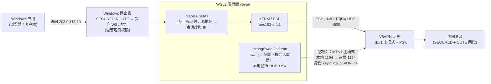
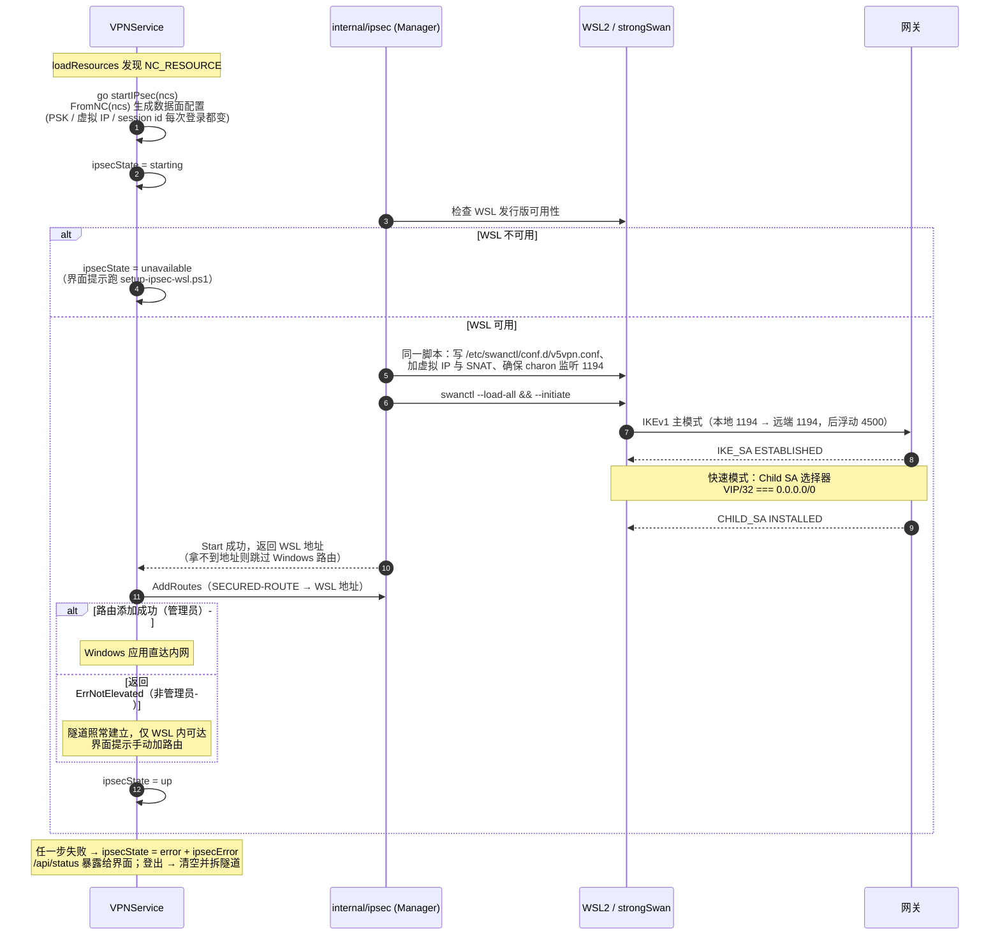

# IPsec（NC 资源）支持现状与实现路径

本文记录 V5VPN 网关下发 `<NC_RESOURCE>`（Network Connect / IPsec 全网状）
时的处理方式，以及完整数据面尚未实现的原因与可选路径。

## 1. NC 资源：是什么，为什么特殊

网关对某些账号策略下发的不是 `<TCPUDP_RESOURCE>`（WEB 资源 / TCP 应用，
客户端为每个资源起本地代理并用 HTTP CONNECT 透传），而是一个
`<NC_RESOURCE>`：

```xml
<RESOURCE_LIST>
  <NC_RESOURCE name='nc'>
    <IKE version='v1'>
      <SERVER ip='198.51.100.10' port='1194' id-type='ipv4' id='198.51.100.10'/>
      <CLIENT port='500' id-type='key_id' id='<session-id>'/>
      <Exchange mode='main'/>
      <PSK key='<pre-shared-key>'/>
    </IKE>
    <PRIVATE-IP ip='10.70.0.5' subnet='255.255.255.255'/>
    <TUNNEL tunnel-name='办公网' mapid='198.51.100.10' status='1'>
      <EXTENSIONS>
        <SECURED-ROUTE><ROUTE addr='198.51.100.0/24'/></SECURED-ROUTE>
      </EXTENSIONS>
    </TUNNEL>
  </NC_RESOURCE>
</RESOURCE_LIST>
```

这是 **IKEv1 主模式 + 预共享密钥 + ESP 隧道模式** 的全网状 IPsec，
客户端拿到的是一组内网路由（`SECURED-ROUTE` / `SECURED-ROUTES`）和一个
虚拟内网 IP（`PRIVATE-IP`）。原厂客户端通过内核虚拟网卡
（`SecTap.sys` / `ndislwf.sys`）承载这些路由；本客户端没有内核态组件，
数据面交给 WSL2 里的 strongSwan 承载（见 §2）。

解析与编排的分工：

- `internal/protocol/models.go` 解析 `NC_RESOURCE`（IKE 参数、虚拟 IP、
  隧道与路由）；`PSK` 带 `json:"-"`，不会进入 API 或界面。
- `SummarizeNCResources` 生成不含密钥的摘要，`/api/status` 以
  `ipsecResources` 下发。
- NC 隧道不产生本地代理行：当 TCP/UDP 资源为 0 时，资源表列出下发的
  隧道名称与路由，并按 `ipsecState` 给出隧道状态（状态条见连接页顶部），
  而不是只显示「未发现资源」。
- 资源加载后若存在 NC 资源，日志记录一条 INFO 并异步拉起隧道；
  建立失败以 ERROR 记录，便于排查「登录成功但 0 资源」。

## 2. 数据面：WSL2 + strongSwan（已实网验证）

数据面不在 Go 里重写 IKE，而是把 strongSwan 跑在 WSL2 里，Go 侧负责编排：



实线是用户数据的路径（Windows 路由 → WSL SNAT → ESP），虚线是 IKE
控制面。Go 侧不在这张图里——`internal/ipsec` 的工作是**编排**：生成
swanctl 配置、拉起连接、加路由，见下面的时序：



- `internal/ipsec`：从 NC 资源生成 swanctl 配置，启动/停止连接，管理路由与 SNAT。
- `VPNService`：资源拉取成功后自动启动隧道，`/api/status` 暴露
  `ipsecState` / `ipsecError`，界面显示状态条。
- Windows 路由：把每个 `SECURED-ROUTE` 指向 WSL 地址；WSL 内把发往这些目标
  网段的数据包源地址 SNAT 为会话虚拟 IP，再交给 XFRM/ESP。添加 Windows 路由需要管理员权限；
  非管理员时隧道仍然建立，但只有 WSL 内可访问，界面会提示。

### 2.1 实网验证到的关键参数（勿随意改动）

| 项 | 值 | 说明 |
|:---|:---|:---|
| IKE 版本/模式 | IKEv1 主模式 | 网关返回 `Exchange mode='main'` |
| IKE 端口 | **本地 1194 → 远端 1194** | 从 500 发不会得到任何回应；这是最容易踩的坑 |
| IKE 提案 | `aes192-sha1-modp1024` | 与网关协商结果一致 |
| ESP 提案 | `aes192-sha1` | AES-CBC-192 / HMAC-SHA1-96 |
| 客户端身份 | `keyid:<SESSION id>` | 会话 ID 每次登录变化 |
| 虚拟 IP | `PRIVATE-IP` | 每次登录变化 |
| Child SA 选择器 | `<VIP>/32 === 0.0.0.0/0` | 不是按 SECURED-ROUTE 逐条协商 |
| NAT-T | UDP 4500 | 主模式后自动浮动到 4500 |

验证结果：IKE_SA/CHILD_SA 均为 ESTABLISHED/INSTALLED；从 WSL 与 Windows
访问 `203.0.113.10:443`、`203.0.113.11:443` 均能建立连接，SA 双向计数
正常增长。

### 2.2 测试覆盖（无 WSL 也能验证的部分）

mock 网关支持 `-nc` 夹具（`only` 替换 TCP/UDP 列表、`mixed` 并存，地址为
TEST-NET、PSK 为显式 mock 值），分四层守卫：

| 层 | 位置 | 验什么 |
|:---|:---|:---|
| 协议解析 | `test/mock/v5vpn/nc_integration_test.go` | IKE/虚拟 IP/路由完整到达客户端；摘要 JSON 不含 PSK；`FromNC` 可生成数据面配置 |
| service 状态机 | `internal/service/vpn_service_ipsec_test.go` | `ipsecState` 在 unavailable / up / error 间的迁移与清理（注入 fake Runner，不碰真实 WSL） |
| UI 端到端 | `test/e2e_ui_test.js --scenario=v5vpn-nc` | 0 TCP/UDP 时资源表进入 NC 分支、状态条渲染、`/api/status` 摘要完整、PSK 不泄漏 |
| 实网 | `internal/ipsec/live_test.go`（`IPSEC_PORTAL_XML` 启用） | 真实网关的 SA 建立 |

无 WSL 的机器上，E2E 里 `ipsecState` 落到 `unavailable` 属预期——
这验证的正是状态机与界面提示，而非隧道本身。

一次性准备（管理员，需重启一次）：

```powershell
# 1) 启用 WSL 功能（DISM），重启
dism /online /enable-feature /featurename:Microsoft-Windows-Subsystem-Linux /all /norestart
dism /online /enable-feature /featurename:VirtualMachinePlatform /all /norestart

# 2) 导入发行版并安装 strongSwan
.\scripts\setup-ipsec-wsl.ps1 -RootFS C:\wsl\ubuntu-base-24.04.tar.gz
```

之后每次登录：客户端写入 `/etc/swanctl/conf.d/v5vpn.conf`，确保 charon 监听
1194，`swanctl --load-all` + `--initiate`，再添加 SNAT 与 Windows 路由。

已知限制：

- Windows 路由需要客户端以管理员运行；否则只能在 WSL 内访问内网。
- 每次登录的 PSK / 虚拟 IP / session id 都会变化，配置按会话重建。
- 会话被强制结束（直接杀进程）时不会执行清理；重新登录会覆盖配置，
  但旧的 SNAT 规则需要 `iptables -t nat -S POSTROUTING` 手动核对。

### 2.3 无 WSL 环境时的表现与降级策略

如果 Windows 用户机器上未安装 WSL 或未导入 `v5vpn` 发行版：

- **登录与非 NC 资源零影响**：
  - TCP/UDP 单端口映射（L4 本地转发）与网页/端口区间资源（本地回环 CONNECT 代理 + 系统 PAC）
    完全由宿主机 Go 进程在用户态承载，不依赖任何虚拟网卡、内核驱动或 WSL，
    也不需要管理员特权，登录后完全正常可用。
- **NC 资源独立降级**：
  - 登录成功并解析出 `NC_RESOURCE` 后，后台异步探测 WSL 发行版可用性；
  - 若未检测到 WSL，`ipsecState` 状态机落到 `unavailable`，前端资源列表仍
    正常展示，连接页顶部状态条给出明确提示（「未检测到 WSL 环境，请运行配置脚本」）；
  - 隧道拉起失败不会阻断用户登录流程，亦不会影响其它已连接的代理端口。
- **用户的处置选择**：
  1. **一次性配置 WSL**：以管理员身份运行 `scripts/setup-ipsec-wsl.ps1`
     （启用 WSL 与虚拟机平台特性、导入内置 strongSwan 的 Ubuntu rootfs，需重启系统一次）；
  2. **网关改配应用资源**：若受限于公司 IT 策略无法开启 Hyper-V / WSL2，可联系
     网关管理员将该账号的权限从全网状 NC 资源变更为具体的 TCP/UDP 应用端口资源，
     即可彻底免除 WSL 依赖与提权需求。

## 3. 其他实现路径（备选）

### A. 当前方案（WSL2 + strongSwan）

见上。优点：复用成熟的 IKEv1/ESP 实现；缺点：依赖 WSL2 和管理员权限。

### A'. Linux 宿主机原生 strongSwan（单平台低成本扩展）

Linux 内核原生自带 XFRM（IPsec 协议栈）与 Netfilter，宿主机可直接运行
strongSwan 守护进程（charon），完全不需要 WSL 这层虚拟机开销：

- **原理与优势**：Go 侧编排逻辑（`swanctl.conf` 配置生成、`iptables` SNAT、
  路由管理）与 Windows WSL 方案完全同构，仅需去掉 `wsl.exe` 调用；工作量
  相比从零自写协议栈小一个数量级。
- **代价与局限**：依赖系统包管理器安装 strongSwan（非单二进制自包含），
  且添加路由与操作 XFRM/iptables 仍需宿主系统的 `root` 或 `CAP_NET_ADMIN`
  特权。当前客户端未接管宿主 strongSwan，主要是因 `internal/ipsec/manager.go`
  仍以 Windows 桌面为主、硬编码了 WSL 调用。

### B. 用户态自实现（wintun / utun / XFRM）

可行性：**技术成立，属于工程量大但路径已知的问题**。依据有三：
wireguard-go 证明 Go 用户态 VPN 数据面可在三平台承载；strongSwan
libipsec 证明 IKE/ESP 可脱离内核；最重要的是 §2.1 已实网锁定全部
互操作参数——IKE 自实现最怕的「对端网关认什么」（提案、模式、端口
怪癖）已不是未知数，本路线是照着已知答案写，不是探索。难点清单：

| 难点 | 内容 | 评估 |
|:---|:---|:---|
| IKEv1 全栈 | 主模式 6 报文 + PSK 认证 + 快速模式 + DPD + 重协商 + NAT-T | **大头，数千行级**；Go 无生产级现成库，基本手写 |
| ESP 数据面 | 序列号 + 抗重放窗口 + AES-CBC-192 + HMAC-SHA1-96 + UDP 4500 封装 | 性能无忧（AES-NI），烦在细节正确性 |
| TUN 层 | wintun / utun / TUN 三套平台 API | 各平台百行级绑定，自写可行；wireguard-go 的 tun 包是 GPLv2，复用有传染性，视项目许可取舍 |
| 特权 helper | Windows 服务 / launchd / systemd + IPC 权限校验 | **被低估的一半工程**：写坏即本地提权漏洞 |
| 测试裁判 | mock 网关只有 REST 层，无 IKE/ESP 服务端 | 按「mock 是裁判」约定，动工前需先给 mock 实现 IKEv1 |
| 端口冲突 | 本地 1194 是网关怪癖要求 | A 绑在 WSL 独立网络栈里宿主不占；B 直接 bind 宿主端口，与原厂客户端同跑会竞争 |
| 并发竞态 | IKE 状态机 × TUN 读循环 × 重协商定时器 × 登出清 SA | 锁设计先行，`-race` 全覆盖 |
| 长尾 | NAT keepalive、DPD 超时、SA 过期重协商、崩溃恢复 | 上线后的主要维护成本 |

一个重要缓解：**本实现是单对端专用，不是通用 IPsec 客户端**——只需
复刻网御网关认的那一组参数（§2.1 已全部锁定），无需实现 IKEv1 全集
的提案组合与兼容分支，工作量比「通用」砍掉一大截。同样要划清两个
**不是问题**：性能（AES-NI 下用户态每包处理对 VPN 量级绰绰有余，
Linux XFRM 变体还可把 ESP 留内核）与互操作（参数已实网锁定）。

对应的两个长期代价：

- **密码学正确性责任转移**：A 路线的 SA 协商与抗重放是 strongSwan
  二十年 hardened 的实现；B 路线这些全在自己手里，一个状态机 bug
  就是 CVE。Go 的加密原语安全，但协议组合的安全性自己负责。
- **Windows 过渡期双数据面**：A 已实网落地，B 渐进上线的合理次序
  是先补 Linux/macOS（A 够不到的平台），Windows 保留 WSL——
  过渡期内两套数据面并存维护。

落地次序（把双数据面过渡期缩到最短）：

1. **mock 先行**：给 `test/mock/v5vpn` 实现 IKEv1 服务端——裁判
   先立、实现后对，这是 B 的第一块里程碑；
2. IKE/ESP 核心按 §2.1 参数实现，单测 + 对 mock 互测；
3. B 先上 Linux/macOS（A 够不到的平台，无迁移成本）；
4. Windows 最后切到 wintun、A 退役，双数据面合流。

两个必须先说清的边界：

- **「零内核驱动」表述需精化**：Windows 的 wintun 本质是驱动
  （`wintun.sys`，微软签名、WireGuard 维护的通用驱动，与厂商 TAP
  不冲突，驱动冲突痛点不会回来）；macOS utun / Linux TUN 是内核
  原生接口。`vendor-landscape.md` 的「不加载内核驱动」在 B 落地
  后应读作「不加载**厂商私有**驱动」。

#### 为什么特权无法避免（B 路线摆脱的是 WSL2，不是提权）

一个常见的架构疑问是：「既然做成了纯 Go 用户态 IPsec，是不是就能免管理员权限运行了？」

**答案是：不能。全平台三层网络接管都必须系统特权。**

特权的来源不是 IPsec 协议本身（IKE 是普通 UDP 报文通信，ESP 加解密是 CPU 用户态
运算，两者均为普通用户态逻辑，零特权），而是操作系统对**三层网络接管的安全防线**：

1. **创建/打开 TUN 虚拟网卡设备**：
   - Windows：调用 Wintun API 创建适配器需要系统管理员权限；
   - macOS：打开 `/dev/utun` 设备需要 `root` 权限；
   - Linux：打开 `/dev/net/tun` 需要 `root` 或 `CAP_NET_ADMIN`。
2. **系统路由表注入**：
   - 将内网网段（`SECURED-ROUTE`，如 `10.0.0.0/8`）指向 TUN 适配器，全平台
     修改系统路由表均属于内核级特权操作。

因此，**B 路线解决的是摆脱 WSL2 笨重依赖与实现三平台单一二进制，而不是消除特权需求**
（A 路线修改 Windows 路由同样需要管理员权限，二者在特权要求上打平）。

各平台承载的特权形态速查：

| 平台 | 承载 | 特权点 | 用户感知 |
|:---|:---|:---|:---|
| Linux | 原生 strongSwan（A'） | XFRM 注入、路由 | 最优雅：strongSwan 即特权系统服务，装包 sudo 一次，运行时 app 经 VICI socket 免提权 |
| Windows | WSL2（A）/ wintun（B） | 装 WSL、改路由 / 建适配器 | 现状为运行时管理员（`route.exe add`），WSL 内 root 用户无感 |
| macOS | utun（B） | 建适配器、改路由 | 最重：无免提权形态，需一次性 launchd helper 或每次 sudo |

产品化解法是 Tailscale 模式：安装时一次性装 privileged helper
（Windows 服务 / launchd daemon / systemd unit），app 本身保持
非特权，经 IPC 委托特权操作。另有一个零特权降级形态：NC 资源
走本地 socks 代理 + 用户态 ESP（应用手动配代理，同单端口资源的
哲学），代价是失去全网状透明路由。

B 落地后的平台承载——即「全平台 NC 资源可达吗」的答案（数据面
层面：是）：

| 平台 | 承载 | 需要什么 | 相对 A 的收益 |
|:---|:---|:---|:---|
| Windows | wintun + 用户态 ESP | 管理员（或一次性 helper） | 免装 WSL2、免重启 |
| macOS | utun + 用户态 ESP | root（或一次性 helper） | 从「仅展示」变可达 |
| Linux | TUN + 用户态 ESP；或直接 XFRM（ESP 留内核，用户态只写 IKE） | CAP_NET_ADMIN | 从「仅展示」变可达；XFRM 变体工作量减半 |

但 B **不是全平台 NC 的唯一路径**：Linux 上最便宜的是主机原生
strongSwan（XFRM 内核 ESP，编排代码与 A 完全同构，只是不用 WSL），
工作量小一个数量级，代价是依赖系统包管理器、不自包含。

#### 为什么 strongSwan 自身无法达成三平台统一？

既然 Linux 原生 strongSwan 表现良好、Windows 可借道 WSL，能否直接让 strongSwan 覆盖 macOS，从而实现三平台统一？

**结论是：无法在 macOS 走通，strongSwan 自身无法实现桌面三平台统一。**

- **macOS 的协议版本断层（致命硬伤）**：
  - 本网关强制要求 **IKEv1 主模式 (Main Mode) + PSK**；
  - macOS 现代系统级网络框架（NetworkExtension）**仅支持 IKEv2**，根本无法协商
    老旧的 IKEv1 主模式；
  - strongSwan 官方针对 macOS 开发的 GUI 客户端也是基于 Apple NetworkExtension
    框架构建的，因此连上该网关在协议层就直接被拒。
- **桌面 charon 移植成本过高**：
  - macOS 既没有 Linux 的内核 XFRM，也不开放 raw PF_KEY 接口；
  - 若想在 macOS 运行 strongSwan 传统的 `charon` 守护进程，必须自行把
    `kernel-libipsec` 移植桥接到 macOS 的 `/dev/utun` 接口；
  - 该 TUN 适配工作量与自写用户态 ESP（B 路线）几乎完全重叠，且项目还需额外背负
    strongSwan 复杂的 C 语言跨平台交叉编译与动态库打包分发负担。
- **统一维度的差异**：
  - strongSwan 路线（A/A'）的「统一」仅停留在 Go 编排层的 swanctl 脚本同构，
    底层运行时在各平台完全割裂（Windows 依赖 WSL2、Linux 依赖系统 apt/dnf 包、macOS 不可用）；
  - 只有纯 Go 用户态 IPsec（B 路线）才能做到**二进制级别的真统一**（单二进制无外部运行时、
    自包含、消除退出残留）。

### C. 复用原厂 IPsec 栈

- 通过 32 位辅助进程加载原厂 DLL 并驱动其 IPsec 引擎。
- 依赖已安装的原厂客户端，不能随项目分发，跨机器不可用；仅适合本机临时方案。

### D. 方案对比总览

| 方案 | 跨平台覆盖 | 外部运行时依赖 | 特权需求与触发时机 | 驱动/内核影响 | 优缺点与定位 |
|:---|:---|:---|:---|:---|:---|
| **A. WSL2 + strongSwan**<br/>*(当前实网落地)* | 仅 Windows | 强依赖 WSL2 虚拟机、Ubuntu rootfs、strongSwan | 运行时需管理员（注入 Windows 路由；WSL 内部免感） | 零宿主驱动；流量经 Hyper-V 虚拟网络进入 WSL 内核 XFRM | **现状方案**：复用成熟 IKEv1 栈落地最快；缺点是安装包大、需启用 WSL 并重启一次 |
| **A'. 宿主机 strongSwan**<br/>*(单平台扩展)* | 仅 Linux | 依赖系统包管理器安装 strongSwan 软件包 | 需 `root` 或 `CAP_NET_ADMIN`（XFRM/路由） | 零专有驱动；直接使用 Linux 原生 XFRM/Netfilter | **Linux 最佳捷径**：免虚拟机、编排同构；缺点是无法自包含、依赖宿主环境 |
| **B. 纯 Go 用户态 IPsec**<br/>*(长期演进目标)* | Windows / macOS / Linux **三平台统一** | **零外部依赖**（纯 Go 单二进制自包含分发） | 建 TUN 网卡与改路由需特权（推荐 Privileged Helper 一次性安装） | Windows 需通用 `wintun.sys`（无厂商冲突）；macOS/Linux 使用系统原生 TUN | **终极形态**：全平台同构、真自包含；缺点是工程量大（手写 IKEv1/ESP、Privileged Helper） |
| **C. 原厂 DLL 注入**<br/>*(本机临时方案)* | 仅 Windows | 强依赖本机已安装的原厂 32 位客户端及相关 DLL | 依原厂权限要求（通常需管理员） | 依然依赖原厂私有内核驱动（`SecTap.sys`） | 仅能作为逆向测试或本机过渡验证，不可分发 |

## 4. 结论

- **现状落地（A 路线）**：Windows 上 NC 账号通过 WSL2 + strongSwan 承载，
  已实网验证通过（管理员一次性配置 WSL2 + strongSwan，接受一次重启）。
- **无 WSL / 非 Windows 环境的表现**：
  - TCP/UDP 单端口映射与网页/区间 PAC 代理全平台可用，零驱动、零特权、零 WSL 依赖；
  - NC 资源降级为 `unavailable` 并给出提示，用户可选择跑脚本安装 WSL，或由管理员改配为应用资源。
- **跨平台可行性定性**：
  - Linux 宿主机原生 strongSwan（A' 路线）低成本可行；
  - macOS 受限于系统 NetworkExtension 仅支持 IKEv2 以及缺少 XFRM/PF_KEY，无法复用 strongSwan；
  - strongSwan 自身无法达成桌面三平台统一。
- **长期形态（B 路线）**：
  - 纯 Go 用户态 IPsec（wintun / utun / TUN）是达成三平台统一单二进制的唯一自包含路径；
  - 三层网络接管决定了全平台均无法免除系统管理员特权，产品化方向采用 Privileged Helper 模式。
