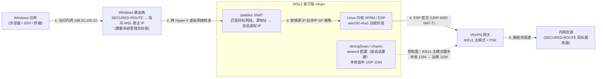

# IPsec（NC 资源）支持现状与实现路径

本文系统阐明 V5VPN 网关下发 `<NC_RESOURCE>`（Network Connect 全网状三层隧道）时的业务目标、技术痛点、当前 Windows 落地现状，以及跨平台统一的备选方案评估与演进代价。

---

## 1. 这个是要干啥？（目标与背景）

在 V5VPN 体系中，网关给客户端下发的内网访问策略分为两类：

1. **应用资源（`<TCPUDP_RESOURCE>` / `<WEB_RESOURCE>`）**：
   - 针对特定目标 IP 和单个端口（如 `10.70.0.10:80`）；
   - 客户端在本地回环起监听代理（L4 端口转发或 L7 HTTP CONNECT 代理），应用流量发往本地回环端口即可直达，**零特权、零驱动、全平台通用**。
2. **NC 资源（`<NC_RESOURCE>`，全网状三层网络直连）**：
   - 网关下发的是一组内网网段路由（`SECURED-ROUTE`，如 `10.0.0.0/8`、`198.51.100.0/24`）和一个会话虚拟内网 IP（`PRIVATE-IP`）：

```xml
<RESOURCE_LIST>
  <NC_RESOURCE name='nc'>
    <IKE version='v1'>
      <SERVER ip='198.51.100.10' port='1194' id-type='ipv4' id='198.51.100.10'/>
      <CLIENT port='500' id-type='key_id' id='<session-id>'/>
      <Exchange mode='main'/>
      <PSK key='<pre-shared-key>'/>
    </IKE>
    <PRIVATE-IP ip='10.70.0.5' subnet='255.255.255.255'/>
    <TUNNEL tunnel-name='办公网' mapid='198.51.100.10' status='1'>
      <EXTENSIONS>
        <SECURED-ROUTE><ROUTE addr='198.51.100.0/24'/></SECURED-ROUTE>
      </EXTENSIONS>
    </TUNNEL>
  </NC_RESOURCE>
</RESOURCE_LIST>
```

> **说明**：文档中出现的 `198.51.100.0/24` 和 `203.0.113.0/24` 遵循 [RFC 5737](https://datatracker.ietf.org/doc/html/rfc5737) 文档保留网段规范（TEST-NET），**仅作为示例与本地 Mock 夹具地址**，避免泄露真实政企内网拓扑。真实环境中此处的 IP、端口与路由网段均由网关动态下发。

- **核心诉求**：客户端认证成功后，需要建立一条标准 IPsec 隧道（IKEv1 主模式 + PSK + ESP 隧道），使得用户无论是在浏览器中输入内网网段内的任意 IP，还是在终端中执行 `ssh`、`ping`、数据库连接，流量都能被透明接管并送入 VPN 隧道。
- **项目定位约束**：原厂客户端通过强装闭源专有内核驱动（`SecTap.sys` / `ndislwf.sys`）来实现网络接管，这极易与其它 VPN、杀毒软件或虚拟机（VMware/VirtualBox）引发蓝屏或断网冲突。本项目的原则是**杜绝厂商私有驱动，避免驱动冲突与系统崩溃**。

---

## 2. 遇到了什么问题？（核心难点与冲突）

要实现 NC 资源的全网状透明接管，在工程落地上面临以下四大核心难点：

### 2.1 协议老旧与网关怪癖
- **强制使用 IKEv1 主模式（Main Mode）**：网关不支持现代 IKEv2，强制要求经典的 6 报文主模式 + 预共享密钥（PSK）握手。
- **非标准端口怪癖**：控制面通信网关强制要求**本地 UDP 1194 端口向远端 UDP 1194 端口握手**（非标 500 端口）。从标准 500 端口发出的包网关直接静默丢弃。
- **系统原生栈断层**：现代操作系统对老旧协议已逐步封杀。以 macOS 为例，其现代系统级网络框架 `NetworkExtension` 仅支持 IKEv2，完全无法与该网关完成协商。

### 2.2 三层接管必须具备操作系统最高特权
- 普通端口代理只需 bind 本地非特权端口（如 `127.0.0.1:随机高端口`），零特权；
- 但全网状三层网络需要：
  1. **创建/打开 TUN 虚拟网卡设备**；
  2. **向操作系统路由表注入网段条目**（如 `route add 198.51.100.0/24 ...`）。
- **特权不可绕过**：无论是 Windows、macOS 还是 Linux，操作系统内核安全模型严格限制了修改路由表和操作底层网络接口的权限，**必须拥有管理员权限（Administrator / root / CAP_NET_ADMIN）**。

### 2.3 其他网络软件开启 TUN 模式引发的路由抢占与流量劫持
在实际运行环境中，当宿主机同时运行其他开启了「TUN 模式」的网络或代理软件时，常出现 VPN 控制面已显示连接成功，但所有内网服务均无法访问的现象。这是操作系统三层网络接管的底层互斥规律：**单一系统的三层全局路由只能由一个虚拟网卡有效接管，访问内网网段与开启其他全局 TUN 工具在路由层天然冲突，二者无法并存**。

- **冲突机理**：
  - 其他网络或代理工具开启「TUN 模式」后，通常会以最高优先级向系统注入覆盖全网的默认兜底路由（如 `0.0.0.0/1` 和 `128.0.0.0/1`），甚至在底层网络驱动（如 Windows WFP）强制拦截所有外发数据包；
  - 当 VPN 客户端把 `198.51.100.0/24` 的路由加入系统时，发往内网资源的数据包依然会被其他软件的 TUN 虚拟网卡优先截获；
  - 其他软件根本无法识别政企内网私有网段，流量被错误转发至外部节点或直接丢弃，导致内网彻底失联；
- **关键结论与要求**：
  - **要访问内网资源就不要同时开启其他 TUN 软件**（原厂客户端同样无法避免此冲突）；
  - 客户端必须具备明确的**强提醒机制**：在内网连不上时，第一时间提醒用户**必须彻底关闭其他网络工具的 TUN 模式，否则内网无法正常使用**。

### 2.4 跨平台操作系统内核网络栈割裂
- **Windows**：网络栈闭源，没有 Linux 原生 XFRM 概念，三层接管通常依赖 NDIS 虚拟网卡；
- **Linux**：原生自带成熟的 XFRM 内核态 IPsec 与 Netfilter；
- **macOS**：无 XFRM，关闭了 raw PF_KEY，封闭性极高。

---

## 3. 目前现状：Windows WSL2 + strongSwan 是如何跑通的？

为了在不侵入 Windows 内核、不自写庞大 IKEv1 协议栈的前提下最快落地验证，当前版本采用了 **方案 A（WSL2 + strongSwan）**。

### 3.1 架构与转发流程



### 3.2 转发核心：iptables SNAT 的技术必要性
流量经 Windows 路由表引导进入 WSL 内部后，不能直接转发至外网，必须经过 SNAT 地址改写，根本原因在于网关的安全策略选择器机制：

- **根本原因**：网关在 IKE 快速模式协商时下发的 Child SA 安全策略选择器（Traffic Selector）是：
  $$\text{Local (VIP)/32} \iff \text{Remote 0.0.0.0/0}$$
- 当 Windows 应用程序发起访问时，数据包跨过 Hyper-V 虚拟网卡到达 WSL，此时报文的**源 IP 是 Windows 在 WSL 子网中的宿主 IP**（如 `172.28.0.1`）；
- Linux 内核 XFRM 安全策略（SP）严格校验源地址：只有源 IP 等于会话虚拟 IP（`VIP`，如 `10.70.0.5`）的包，内核才会触发 ESP 加密封装。源 IP 为 `172.28.0.1` 的报文无法命中 SA 策略，会被直接按明文路由转发或丢弃；
- 因此，Go 客户端通过脚本在 WSL 的 `POSTROUTING` 链添加了 SNAT 规则：
  ```bash
  iptables -t nat -A POSTROUTING -d <SECURED-ROUTE> -m comment --comment v5vpn-ipsec -j SNAT --to-source <VIP>
  ```
  精准将发往内网目标网段的数据包源 IP 替换为会话 VIP，随后报文顺利命中 XFRM 策略完成加密投递。

### 3.3 实网验证锁定的关键参数（勿随意改动）

| 参数项 | 实网协商结果 | 说明 |
|:---|:---|:---|
| IKE 版本与模式 | IKEv1 主模式（Main Mode） | 网关固定下发 `Exchange mode='main'` |
| 控制面握手端口 | **本地 UDP 1194 $\rightarrow$ 远端 UDP 1194** | 网关特殊要求；从 500 端口握手会被丢弃 |
| IKE Phase 1 提案 | `aes192-sha1-modp1024` | 3DES/AES256 等均被网关拒绝 |
| ESP Phase 2 提案 | `aes192-sha1` | AES-CBC-192 / HMAC-SHA1-96 |
| 客户端 IKE 身份 | `keyid:<SESSION_ID>` | 会话 ID 每次登录动态变化 |
| 虚拟内网 IP | `PRIVATE-IP` | 网关每次登录动态分配 |
| Child SA 选择器 | `<VIP>/32 === 0.0.0.0/0` | 全网状单端选择器，非逐条路由协商 |
| NAT-T 穿越 | 自动浮动到 UDP 4500 | 主模式第 5/6 报文完成后，后续转入 UDP 4500 封装 |

实测结果：IKE_SA 与 CHILD_SA 双向建立稳定，Windows 宿主机应用访问内网 Web 与端口完全正常，双向流量计数平稳增长。

### 3.4 部署要求、已知限制与无 WSL 时的降级策略

#### 1) 首次使用的一次性准备（需管理员 + 重启一次）
```powershell
# 1. 开启 WSL2 与虚拟机平台
dism /online /enable-feature /featurename:Microsoft-Windows-Subsystem-Linux /all /norestart
dism /online /enable-feature /featurename:VirtualMachinePlatform /all /norestart

# 2. 导入内置 strongSwan 的 Ubuntu 发行版
.\scripts\setup-ipsec-wsl.ps1 -RootFS C:\wsl\ubuntu-base-24.04.tar.gz
```

#### 2) 如果 Windows 用户没有安装 WSL，会发生什么？
- **非 NC 资源完全不受影响**：单端口应用资源和网页 PAC 代理完全由宿主机用户态进程处理，**不需要管理员权限，不需要 WSL，零驱动，登录后即刻可用**；
- **NC 资源独立降级**：客户端登录后异步检测 WSL 发行版，若检测失败，`ipsecState` 标记为 `unavailable`，前端资源列表正常渲染，并在连接页顶部显示警示条（提示运行环境准备脚本），**绝对不会引起客户端崩溃或阻断其它已连接的业务**；
- **用户的选择**：
  1. 运行一次初始化脚本安装 WSL2；
  2. 若因安全管控无法开启 WSL2，联系管理员将该账号的策略由全网状 NC 调整为具体的 TCP/UDP 应用端口映射。

#### 3) 已知限制
- **必须以管理员身份运行客户端**：向 Windows 路由表执行 `route.exe add` 必须提权，非管理员时隧道虽然能在 WSL 内部建起，但宿主机应用流量无法流入；
- **异常退出残留**：若客户端被任务管理器强制杀死，WSL 内的 iptables SNAT 规则与 Windows 路由表条目无法触发 `Stop()` 清理，需在重连时覆盖或手动排查。

---

## 4. 怎么彻底解决问题？有哪几种方案与评估？

虽然方案 A（WSL2）成功跑通了 Windows 上的实网流量，但它的缺陷十分明显：**需要安装庞大的 WSL2 虚拟机，需要重启电脑，且无法覆盖 macOS 和 Linux**。为此，我们需要评估更彻底的解法。

### 方案 A'：Linux 宿主机原生 strongSwan（低成本单平台扩展）
- **解决思路**：Linux 宿主机自带 XFRM 与 Netfilter，宿主机直接运行 `strongSwan (charon)`。Go 客户端的编排代码（配置生成、`swanctl` 加载、`iptables` SNAT）与方案 A 完全同构，只需去掉 `wsl.exe` 调用。
- **代价与权衡**：
  - 优点：Linux 上无需虚拟机，性能优异，开发成本极低（数人天即可接入）；
  - 缺点：强依赖宿主机系统包管理器安装 strongSwan（非单二进制自包含），且操作 XFRM 和路由仍需宿主机 `root` / `CAP_NET_ADMIN` 特权。

### 4.2 strongSwan 无法作为三平台统一方案的技术论证（macOS 路线彻底否定）
将 strongSwan 作为跨平台通用后端的路线在 macOS 上属于技术死胡同，已被架构层面彻底否定：

1. **协议断层硬伤**：macOS 官方在系统级网络框架 `NetworkExtension` 中**仅支持现代 IKEv2**，早已废弃老旧的 IKEv1 主模式。strongSwan 官方发布的 macOS 客户端是基于 NetworkExtension 开发的，连上该网关直接报协议不支持。
2. **内核后端缺失与移植代价**：
   - Linux 依靠内核 XFRM，FreeBSD 依靠 `PF_KEY`；macOS 既没有 XFRM 也不开放 raw PF_KEY；
   - 若要在 macOS 上运行传统 strongSwan 守护进程，必须使用其 `kernel-libipsec` 插件（一个用户态 ESP 加解密实现），并通过代码将其桥接到 macOS 原生的 utun 接口；
   - **代价严重倒挂**：这一套工作量等同于自行编写用户态 TUN 驱动，而且还要额外背负 strongSwan 庞大的 C 语言依赖、跨平台交叉编译与数十兆动态库的分发包袱，得不偿失。

### 方案 B：纯 Go 用户态自实现 IPsec（终极演进形态）
- **解决思路**：参考通用纯用户态 VPN 架构（如 WireGuard-go 等），由 Go 客户端在用户态全自研实现 IKEv1 主模式状态机 + ESP 加解密（UDP 4500 封装），并借助成熟的通用虚拟网卡驱动（Windows 下的 `wintun`、macOS 原生的 utun 接口、Linux 原生的 `/dev/net/tun`）完成三层数据包收发。

#### 1) 特权边界辨析：B 路线摆脱的是外部依赖，而非系统特权
纯 Go 用户态实现无法免除系统管理员权限，特权是三层网络接管的操作系统底层红线：

**答案是：依然必须特权。B 路线摆脱的是 WSL2 虚拟机的笨重依赖，而不是提权需求。**

特权的来源不是 IPsec 协议本身（IKE 是普通 UDP 报文通信，ESP 是纯 CPU 内存计算，零特权），而是**操作系统对三层网络接管的安全底线**：
1. **创建/打开 TUN 网卡**：Windows 打开 Wintun 必须管理员权限，macOS 创建 utun 接口（PF_SYSTEM 控制套接字）和 Linux 打开 `/dev/net/tun` 必须 `root` / `CAP_NET_ADMIN`；
2. **修改系统路由表**：向操作系统核心路由表中添加 `198.51.100.0/24` 的指向条目，全平台都必须管理员权限。

#### 2) 产品化解法：Privileged Helper 架构
为了避免用户每次点击连接都弹出 Windows UAC 提权窗或要求输入 `sudo` 密码，成熟做法是采用 **Privileged Helper** 架构（系统后台服务守护进程）：
- 客户端在首次安装或首次初始化时，申请一次特权，向操作系统注册一个常驻轻量后台服务（Windows Service / macOS LaunchDaemon / Linux systemd）；
- 日常前台 GUI 客户端以普通低权限用户运行；
- 登录成功拿到 NC 路由后，前台通过本地 RPC/IPC 通知 Helper 执行 TUN 设备创建与路由注入，达成日常运行**零弹窗、零中断**。

#### 3) 其他网络软件开启 TUN 模式时的排查与强提醒机制
在三层网络方案落地与日常使用中，必须建立明确的防冲突提醒：
- **单机三层网络互斥底线**：访问政企内网三层资源时，严禁同时开启其他全局接管类网络软件；要访问内网就不要同时进行其他全局网络分流操作；
- **主动诊断与强提醒**：
  - 隧道建立后，客户端若探测到内网网段连通性异常，或检测到系统存在多个活动中的虚拟网卡，界面必须弹出强提醒：
    > **⚠️ 网络冲突提示**：检测到系统中可能存在其他正在运行的 TUN 模式网络软件，内网流量已被其强行接管劫持。**要访问内网资源，请务必先彻底退出或关闭其他软件的 TUN 模式**，否则内网无法正常使用。

#### 4) 方案 B 带来的变动代价与难点评估
| 难点 | 内容说明 | 变动代价与评估 |
|:---|:---|:---|
| **IKEv1 协议栈全自研** | 主模式 6 报文协商 + PSK 计算 + 快速模式 Child SA + DPD + NAT-T | **工程量巨大**：Go 无成熟可靠的开源 IKEv1 库，需手工编写数千行状态机代码 |
| **密码学安全性责任转移** | SA 密钥派生、抗重放攻击滑动窗口、CBC/HMAC 边界对齐 | **维护风险高**：strongSwan 有二十年的实网加固检验，自研状态机若存在死锁或漏洞即直接暴露安全隐患 |
| **测试裁判重构** | 本项目严格遵循「mock 网关是裁判」原则，当前 mock 只有 HTTP 层 | **必须先开发 mock IKEv1 服务端**，裁判先行才能保证自研协议栈的可测性 |
| **TUN 层跨平台绑定** | Windows `wintun` / macOS `utun` / Linux `tun` 三套适配 | 代码量适中（数百行），可复用成熟规范 |
| **特权 Helper 守护进程** | 跨平台系统服务注册 + 本地安全 IPC 校验 | 需编写 Windows Service 和 Unix Daemon 代码，避免 IPC 成为本地提权漏洞 |

### 方案 C：复用原厂 32 位 DLL 引擎（临时验证）
- **解决思路**：通过 32 位辅助进程加载原厂客户端的专有动态库，借其驱动完成握手。
- **评价**：依赖本机已安装的原厂客户端和内核驱动，根本无法作为独立分发的开源客户端，仅可作为逆向分析的对照工具，不可作为长期方案。

---

## 5. 方案对比总览与决策结论

### 5.1 全方案横向对比表

| 方案 | 跨平台覆盖度 | 外部运行时依赖 | 特权需求与触发时机 | 驱动/内核安全影响 | 其他 TUN 软件冲突表现 | 定性评估与架构结论 |
|:---|:---|:---|:---|:---|:---|:---|
| **方案 A：WSL2 + strongSwan**<br/>*(当前落地)* | 仅 Windows | 强依赖 WSL2 虚拟机、Ubuntu 镜像、strongSwan 运行时 | 运行时需系统管理员权限（注入 Windows 路由） | 宿主机零专有驱动；流量经 Hyper-V 跨网络进入 WSL 内核 XFRM | 路由若被其他 TUN 覆盖，内网失联；**必须关闭其他 TUN** | **【当下现状 / Windows 过渡可用】**<br/>复用成熟工业级协议栈，现阶段在 Windows 上最稳妥可用；缺点是依赖重、需重启，非跨平台终极形态 |
| **方案 A'：宿主机 strongSwan**<br/>*(单平台扩展)* | 仅 Linux | 依赖系统包管理器安装 strongSwan 软件包 | 需系统 `root` 或 `CAP_NET_ADMIN` | 宿主机零专有驱动；直接使用 Linux 原生 XFRM/Netfilter | 依赖路由优先级调度；建议关闭其他全局 TUN | **【阶段可选 / 单平台低成本延伸】**<br/>仅适合信创/Linux 桌面快速补齐三层能力，开发成本极低；但无法单二进制分发，且无法解决 macOS |
| **方案 B：纯 Go 用户态 IPsec**<br/>*(终极目标)* | **Windows / macOS / Linux 三平台统一** | **零外部依赖**<br/>（纯 Go 单二进制自包含分发） | 建 TUN 网卡与改路由需特权（推荐 Privileged Helper 一次性安装） | Windows 引入通用轻量 `wintun.sys`（微软签名）；macOS/Linux 使用原生系统 TUN | 同样受三层路由抢占影响；客户端内置强提醒排查机制 | **【推荐 / 跨平台终极彻底解法】**<br/>真正达成三平台单二进制自包含分发，彻底摆脱 WSL2 与系统包依赖；虽需承担自研状态机维护责任，但是唯一正解 |
| **方案 C：原厂 DLL 注入**<br/>*(逆向验证)* | 仅 Windows | 强依赖本机已安装的原厂客户端文件及环境 | 依原厂要求（通常需管理员） | 依然依赖原厂私有内核驱动（`SecTap.sys`），驱动冲突依然存在 | 与原厂客户端表现一致 | **【完全不可行 / 坚决废弃】**<br/>强行绑定原厂闭源环境与专有驱动，违背本项目「杜绝专有驱动冲突」的核心立项宗旨，且存在版权与分发风险 |
| **方案 D：macOS 运行 strongSwan**<br/>*(跨平台尝试)* | 仅 macOS | 需移植 strongSwan charon + kernel-libipsec 动态库 | 创建 utun 接口需 `root` 权限 | 依赖 utun 接口 | 同样存在多 TUN 抢占 | **【完全不可行 / 架构死胡同】**<br/>macOS 系统框架仅支持 IKEv2，强行移植用户态 charon 成本严重倒挂，等同于手写 TUN 却额外背负庞大 C 依赖 |

### 5.2 决策结论

1. **【当下现状】维持方案 A 保障 Windows 可用性**：Windows 端继续沿用 WSL2 + strongSwan 承载，实网已验证其稳定性；未安装 WSL 时优雅降级为 `unavailable` 并给出配置脚本提示，绝不阻断非 NC 资源的使用。
2. **【彻底解决】演进主线锁定方案 B（纯 Go 用户态 IPsec）**：纯 Go 用户态实现是摆脱 WSL2 笨重依赖、实现 Windows/macOS/Linux 三平台单一自包含二进制分发的唯一正确路径。实施次序锁定为 **「mock 裁判先行 $\rightarrow$ 自研 IKEv1/ESP 核心 $\rightarrow$ Privileged Helper 落地 $\rightarrow$ 冲突诊断强提醒」**。
3. **【阶段可选】Linux 信创场景可权衡采纳方案 A'**：若短期内需要低成本覆盖统信 UOS / 麒麟等国产 Linux 桌面，可优先以数人天成本实现宿主 strongSwan 编排（A'）作为阶段性过渡。
4. **【彻底否定】坚决废弃方案 C 与 macOS strongSwan 方案**：原厂 DLL 注入（方案 C）严重违背零驱动冲突原则；macOS strongSwan 路线因系统协议断层和架构倒挂，直接在技术选型中否决。
5. **【操作底线】多 TUN 互斥与用户强提醒**：确立「要访问内网就不能同时开启其他 TUN 软件」的排他原则。在客户端连接诊断中内置活动网卡探测与内网连通性检测，排查到异常时明确向用户提示退出其他 TUN 软件。
