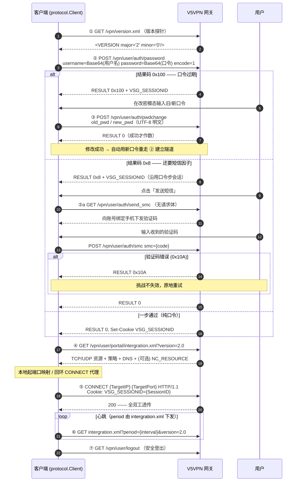

# V5VPN 协议观察分析（本地凭证与网关交互）

本文承接 README「分析过程」索引的技术细节：setting.xml 本地凭证格式、
网关 HTTP 协议的完整交互流程。结论来自对原厂客户端（5.3.3.x）
`SecUI.exe`、`SecController.dll`、`SecLogin.dll`、`SecSSL.dll`、
`VpnServ.exe` 的符号表、反汇编及内存映射的观察分析。

实现约定：`internal/protocol` 的客户端实现严格照本文对齐；行为冲突时以
mock 网关（`test/mock/v5vpn`）为裁判（见 `test/README.md`）。

---

## 1. 本地凭证 (setting.xml)

- **用户名**：标准 Base64 编码。
- **密码**：DES-CBC，PKCS5/PKCS7 填充
- 解密还原率 100%，支持自动导入或反向导出。

## 2. 协议交互流程 (Network Protocol)

先看全景（各步字段细节在图后逐条展开；认证多跳的状态机视角见
[`auth-flow.md`](auth-flow.md)）：

结果码驱动而非流程写死：每提交一个因子，`RESULT` 按位掩码指出下一个
待验因子（`0x1` 口令 / `0x2` 证书 / `0x4` 令牌 / `0x8` 短信 / `0x180`
改密，取最低置位位），客户端循环到 `0` 为止——跳数由网关决定，事先
不可知。

1. **版本探针**：`GET /vpn/version.xml` $\rightarrow$ `<VERSION major="2" minor="0"/>`。
2. **口令认证**：`POST /vpn/user/auth/password`
   - 编码方式：标准 Base64（`SecLogin.dll` 的 base64 例程对用户名与口令各编码一次），Raw 字符串拼接（避免 URL 转义 Base64 尾部字符）
   - **关键参数 `encode`**：`encode=1` 指示网关按 Base64 解码。原厂 5.3.3.x 客户端在整条口令路径上没有任何 AES 加密调用（`SecLogin.dll` 未导入 `CryptEncrypt`，全部件内无 `encode=2` 字样）。
   - 字段：`username={Base64(User)}&password={Base64(Pwd)}&encode=1&verifycode={code}`。
   - 登录成功返回 Session Cookie：`VSG_SESSIONID`。
   - **口令过期识别**：仅以网关结果码 `0x00000100`（十进制 256）为准，与原厂 `SecUI.exe` 的 `cmp eax, 0x100` 分支一致。`0x101`（用户名或口令不匹配）和 `0x8000001A`（密文解析失败）都按账号密码错误处理，即使响应文案提到「口令过期」也不会进入改密流程。若响应为 GBK 编码，客户端会自动转换为 UTF-8 再解析。
2a. **短信认证（多因素，结果码 `0x8`）**：口令校验通过后，网关可再要求短信因子
   （响应文案「多因素认证，短信认证」）。**手机号是网关侧为账号预设的属性**：
   `send_smc` 没有请求体、`smc` 请求体只有验证码一个字段，客户端全程不填写、
   不上送手机号；账号未绑定手机号时网关直接拒绝下发（文案「短信认证用户
   没有设置手机号码」）。两步串行，沿用口令步骤下发的同一 `VSG_SESSIONID`：
   - `GET /vpn/user/auth/send_smc`：请求网关向账号绑定手机下发验证码（对应原厂「发送短信」按钮，带重发倒计时）。
   - `POST /vpn/user/auth/smc`：提交手机收到的验证码，字段 `smc={code}`（原样拼接，无 `encode` 参数）。
   - 结果码 `0x10A`（短信码错误）不失效挑战，可原地重试；成功后按正常登录建立隧道。
   - 短信因子也可接在证书因子之后（口令 → 证书 → 短信，或纯证书 → 短信），
     证书随挑战会话保留到隧道建立。

**网关驱动的认证状态机**：客户端不写死认证流程。每个因子提交后，网关的
`RESULT` 结果码按位指出下一个待验因子（`0x1` 口令、`0x2` 证书、`0x4` 令牌、
`0x8` 短信、`0x180` 改密，取最低置位位），客户端据此分发下一步——与原厂
`SecUI.exe` 的因子掩码跳转一致。因此因子链（口令+证书、口令+短信、
口令+证书+短信、证书+短信……）由网关动态编排，客户端按同一套挑战会话
机制串行完成，新增一种可驱动的因子只需在分发点登记一步。
设计与不变量详见 [`auth-flow.md`](auth-flow.md)。
3. **口令修改**：`POST /vpn/user/auth/pwdchange`
   - 复用收到 `0x100` 登录响应的同一 HTTP 客户端，携带该响应下发的 `VSG_SESSIONID` Cookie。
   - 字段：`old_pwd={OldPwd}&new_pwd={NewPwd}`，两个口令均按 UTF-8 明文提交，不携带 `encode` 参数（原厂客户端的拼装格式即 `old_pwd=%s&new_pwd=%s`）。
   - 只有解析到明确的成功结果码 `0` 才算修改成功；HTTP 200 但缺少结果码或 XML 无法解析均按失败处理。
   - 修改成功后，客户端自动使用新密码完成登录并建立隧道。
4. **获取授权资源**：`GET /vpn/user/portal/intergration.xml?version=2.0`
   - 获得 TCP/UDP 内网资源列表与端口、策略及 DNS。
5. **隧道建立与数据透传**：
   - 本地自动分配代理端口监听。
   - 建立 SSL 连接并发送 `CONNECT {TargetIP}:{TargetPort} HTTP/1.1\r\nCookie: VSG_SESSIONID={SessionID}` 进行全双工透传。
6. **保活心跳**：`GET /vpn/user/portal/intergration.xml?period={interval}&version=2.0`。
7. **安全登出**：`GET /vpn/user/logout`。
