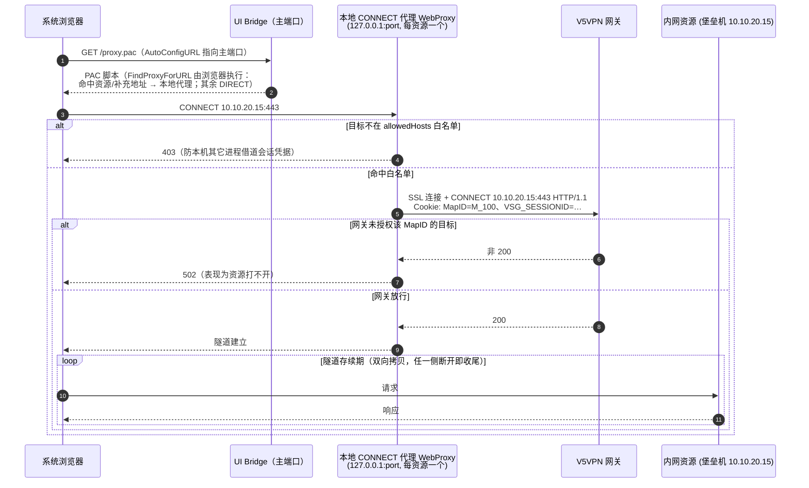
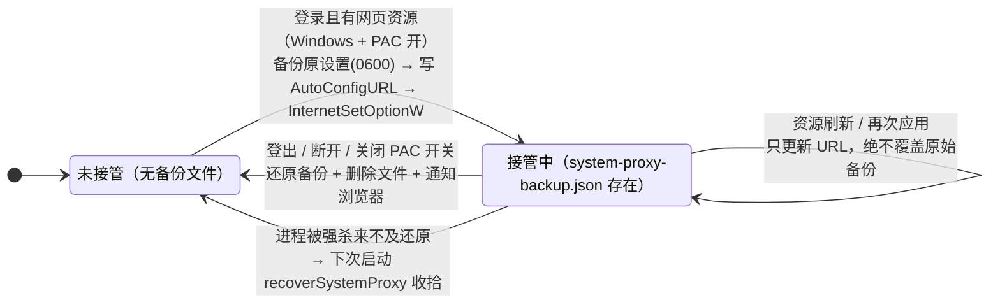

# 网页资源代理与系统 PAC（设计决策）

本文记录「端口区间资源经本地 CONNECT 代理访问」这一机制的架构决策：
资源如何识别、代理如何建隧道、系统 PAC 如何接管与还原。这些决策是
刻意为之的，改动前请先读完本文——任何「改成全局代理」或「把网关下发
的地址原样写进 PAC」的实现都是走偏，会被本文与 `web_resource_test.go`
的守卫拦下。

适用范围：`internal/proxy/webproxy.go`（CONNECT 代理）、
`internal/service/web_resource.go`（资源识别 + PAC 生成）、
`internal/service/web_proxy_config.go`（用户设置）、
`internal/service/systemproxy_*.go`（注册表接管）。aTrust 协议不在此流程内。

---

## 1. 核心认知：这类资源没有端口可映射

V5VPN 网关把堡垒机这类「整台主机」资源下发为：

```xml
<TCPUDP name="堡垒机" mapid="M_100" port="1-65535" addr="10.10.20.15" .../>
```

三个事实决定了方案形态：

- `port` 是区间（`1-65535`），**不存在**可以映射的固定本地端口——旧解析
  按单端口处理失败后被静默丢弃，于是「登录成功但资源列表为空」；
- 目标地址在资源节点的 `addr` 属性上，与 `TCPUDP_IP` 子节点二选一
  （解析回退链：`addr` 优先，缺失时取子节点地址的 `-` 前段）；
- 官方客户端用虚拟网卡让浏览器直接访问内网 IP；本项目不接管路由。

因此客户端的正确姿态只有一种：

> 为每条区间资源起一个仅监听 `127.0.0.1` 的 HTTP CONNECT 代理，浏览器
> 经它访问目标地址，每条连接都以 `Cookie: MapID=<资源 mapid>;
> VSG_SESSIONID=<会话>` 与网关建隧道。

浏览器访问一条区间资源的完整路径：



反面案例（历史上出现过，勿再犯）：
- 系统全局代理（ProxyServer）：把外网流量一并送进 VPN，必须实现直连回退；
- 虚拟网卡（TAP/WinTUN）：需要驱动签名与路由接管，影响面大、回滚困难。

## 2. 分层职责

| 层 | 文件 | 职责 |
|:---|:---|:---|
| 代理 | `internal/proxy/webproxy.go` | 单条资源的 CONNECT 隧道（回环监听、双向拷贝、任一侧断开即收尾） |
| 服务 | `internal/service/web_resource.go` | 识别区间资源、启动/停止代理、生成 PAC、按设置接管系统 PAC |
| 设置 | `internal/service/web_proxy_config.go` | `webproxy-config.json` 读写（PAC 开关 + 额外地址） |
| 系统 | `internal/service/systemproxy_windows.go` | HKCU `Internet Settings` 备份/写入/还原/崩溃恢复 |

生命周期：登录或刷新资源时 `startWebResources` 为每条区间资源建代理并
**整体替换**旧代理列表（先赋值新列表，锁外停旧代理）；登出时全部停止，
并立即还原系统代理。代理停止只关监听，已建立的隧道自行收尾。

## 3. 系统 PAC：只影响目标地址，退出即还原

登录后（仅 Windows，且用户未关闭 PAC 开关）把 HKCU 的 `AutoConfigURL`
指向 `http://127.0.0.1:<本地端口>/proxy.pac`：

- PAC 只把**资源地址与用户补充地址**指向本地代理，其余一律 `DIRECT`
  ——NAS、本机网段、外网全部不受影响；
- 写入前备份原始代理设置（`system-proxy-backup.json`，0600）；断开、
  登出、关闭 PAC 开关时还原并删除备份；
- 进程被强杀来不及还原时，下次启动 `NewVPNService` 里的
  `recoverSystemProxy` 用遗留备份收拾干净；
- 备份文件存在即视为「当前 PAC 是本客户端设置的」：再次应用只更新
  URL，绝不用当前值覆盖原始备份；
- 写入/还原后调用 `InternetSetOptionW` 通知已运行的浏览器重读设置。

非 Windows 平台：系统 PAC 不实现（`systemproxy_other.go` 返回错误），
本地 CONNECT 代理本身仍可用（可用 `--proxy-server` 参数启动浏览器）。

系统 PAC 的接管与还原是一个以**备份文件存在性**为凭据的状态机：



## 4. PAC 生成的安全边界

PAC 是**每次浏览器请求都会执行的 JS**，等价于常驻代码注入面。因此
`PACScript` 的所有插值必须过 `pacSafeToken` 白名单：只允许字母、数字
与 `. * -`（主机名与通配形态），引号/括号/分号等任何其他字符整条丢弃
并记 WARN。两个输入源都要过：

- **网关下发的 `RemoteAddr`**：防被 MITM 或恶意网关注入；
- **用户补充的额外地址**：防恶意网页跨域 POST `/api/web-proxy/config`
  写入载荷（该端点要求 `Content-Type: application/json`）。

`webproxy_test.go` / `web_resource_test.go` 守卫这条边界（恶意 token
不得出现在生成的 PAC 中）。

## 5. 双因子改密

口令 + 证书双因子账号改密失败的根因有两个，修法都遵循「对齐原厂顺序」：

1. **证书呈递顺序**：口令步不带证书（不再预装到连接上）；收到 `0x2`
   证书挑战后用已选证书 `AuthCertOnly` 补完证书因子，再提交 `pwdchange`。
   找不到证书时返回明确提示而不是含糊的「验证当前密码失败」。
2. **编码口径**：明文 `pwdchange` 被判「原密码错误」时，自动换
   Base64 + `encode=1` 重试一次（部分网关版本的 pwdchange 与登录同编码）。
   重试有且仅有一次，`pwdchange_test.go` 守卫不会死循环。

另外 `Handshake` 失败自动重试一次（间隔 500ms，主动取消不重试），
应对网关链路短时重置；认证成功响应里的 `msg`（如「密码还有 X 天过期」）
与 `pwd_overtime` 通过 `GetStatus` 的 `loginNotice` / `passwordExpiryDays`
暴露给界面。

## 6. 用户可见的文件与接口

| 文件 / 接口 | 说明 |
|:---|:---|
| `webproxy-config.json` | PAC 开关（默认开）与额外代理地址（支持 `10.10.20.*` 与 `/8 /16 /24` 网段） |
| `system-proxy-backup.json` | 系统代理备份（还原后删除；存在即代表本客户端接管中） |
| `window-sizes.json` | 登录/已连接/设置三个视图的窗口尺寸 |
| `GET/POST /api/web-proxy/config` | 读写上述设置，保存即生效 |
| `GET /proxy.pac` | 系统 PAC 内容（`no-store`） |

## 7. 已知限制

- 网页资源沿用同一 `MapID`：**需网关侧已授权对应目标**，否则隧道被
  网关拒绝（客户端表现为 502）；
- PAC 按 host 精确/通配匹配，浏览器以主机名（而非 IP）访问资源时
  需把主机名加入额外地址；IPv6 文本地址不支持（`pacSafeToken` 拒绝
  冒号，PAC 的 `shExpMatch` 亦不支持）；
- macOS 上 `OpenWebResource` 用 `open` 直连打开（本地代理不注入），
  非 Windows 平台请手工以 `--proxy-server` 启动浏览器；
- 界面部分（WEB 资源行、代理设置面板）在后续界面 PR 提供。
